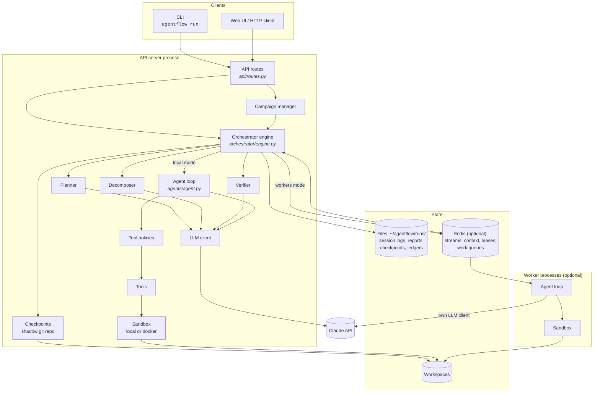

# Architecture

AgentFlow follows a split described in Anthropic's *Managed Agents* work:

- **Brain**: the orchestrator, which decides what to do next.
- **Hands**: sandboxes and workers, where agent-issued work actually executes.
- **Session**: a durable log that outlives both.

Each of the three can be swapped or restarted without the others losing track.

## Components

## What each part is responsible for

| Component | Responsibility | Code |
| --- | --- | --- |
| **API** | HTTP endpoints for runs (start, stream, input, message, cancel, resume, follow-up, history), checkpoints and campaigns. Route handlers only call services. | `api/routes.py` |
| **CLI** | `agentflow run` (submit and stream), `serve`, `health`, `worker`. | `cli/` |
| **Orchestrator engine** | Owns a run from start to end: workspace, session log, lease, plan, scheduling the DAG, dispatching subtasks, retries, fallback agents, budgets and HITL, verification, checkpoints, the report. Also resumes interrupted runs. | `orchestrator/engine.py` |
| **Planner** | Explores the workspace read-only, then writes the plan as JSON (subtasks, dependencies, budget shares, acceptance criteria). | `orchestrator/planner.py` |
| **Scheduler** | Validates the DAG (no cycles, no dangling dependencies) and says which subtasks are ready. | `orchestrator/scheduler.py` |
| **Decomposer** | Splits a subtask into micro-steps at dispatch time, for agents whose manifest asks for it. | `orchestrator/decomposer.py` |
| **Agent loop** | One generic, manifest-driven conversation with Claude: tool calls, adaptive thinking, iteration and budget limits, the context view, recall. | `agents/agent.py`, `agents/context_view.py` |
| **Tool policies** | Run before every tool call and can refuse it (command allowlists, call limits). | `tools/policy.py` |
| **Tools** | Built-ins (files, shell, Python, web, arXiv, documents, skills) and MCP-server tools. | `tools/` |
| **Sandbox** | Where shell and Python commands run: a host subprocess, or a per-run Docker container. | `tools/sandbox.py` |
| **Verifier** | A read-only agent that checks acceptance criteria against the workspace. | `orchestrator/verifier.py` |
| **Checkpoints** | Git snapshots of the workspace in a shadow repo; rolls back a failed attempt's files. | `orchestrator/checkpoints.py` |
| **Resume** | Rebuilds a run's state from its session log and continues it. | `orchestrator/resume.py` |
| **Campaign manager** | Defines a feature ledger, then drives one session (run) per feature until done or out of budget. | `orchestrator/campaign.py` |
| **Workers** | Engine-side remote invoker and the worker process loop (queues, heartbeats, cancel). | `orchestrator/workers.py` |
| **Reporter** | Combines subtask results into the final Markdown report. | `orchestrator/reporter.py` |
| **Session log** | Durable, append-only record of each run, with replay. | `core/session.py` |
| **Run context** | A run's live in-memory state: results, cost, budget, pending human input, message queues (in memory or Redis). | `core/context.py`, `core/context_redis.py` |
| **SSE stream** | The live event feed (in memory or Redis Streams). | `orchestrator/stream.py`, `stream_redis.py` |
| **Leases** | Which process owns a run or campaign (Redis). | `core/lease.py` |
| **LLM client** | Wraps the Anthropic SDK: prompt caching, streaming, usage accounting. | `llm/client.py` |
| **Registry / skills** | Loads manifests and skill packs. | `core/registry.py`, `core/skill_loader.py` |

## How the pieces share state during a run

Each run sets a handful of per-run "current" values when it starts: the workspace, the
session log, the sandbox, the artifact tracker. Everything the run spawns (planner,
subtasks, decomposer, tools) inherits them automatically through Python `ContextVar`s.
That's why a tool such as `file_write` knows which workspace to write to without being
told, and why every agent turn ends up in the right session log.

## Two kinds of state

- **Durable** (on disk, under `~/agentflow/runs/`, `RUNS_DIR`): the session log, `meta.json`, the report,
  checkpoints and campaign ledgers. These survive restarts, and everything that has to
  survive a restart is rebuilt from them.
- **Live** (memory or Redis): the SSE stream, run context, leases and work queues. These
  coordinate a run *while it executes* and can expire afterwards.

See [Data & storage](data-and-storage.md) for the layout, and
[Deployment modes](deployment-modes.md) for when Redis is involved.
