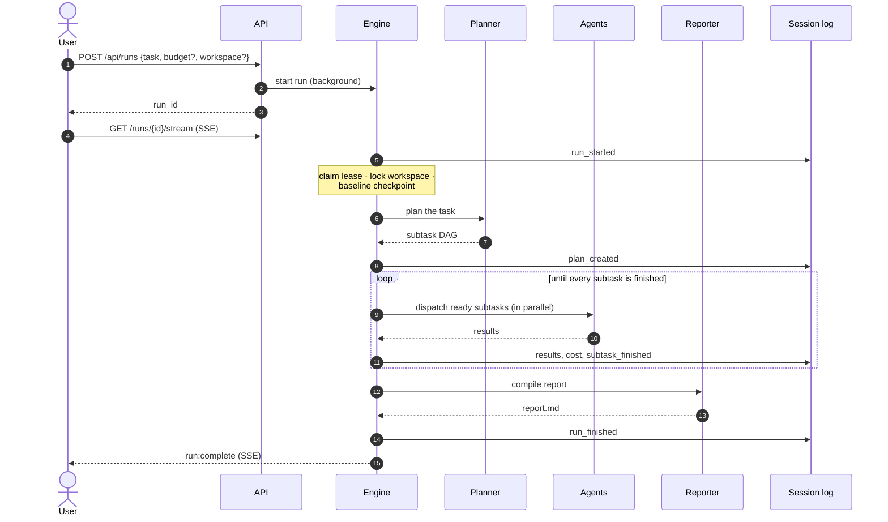
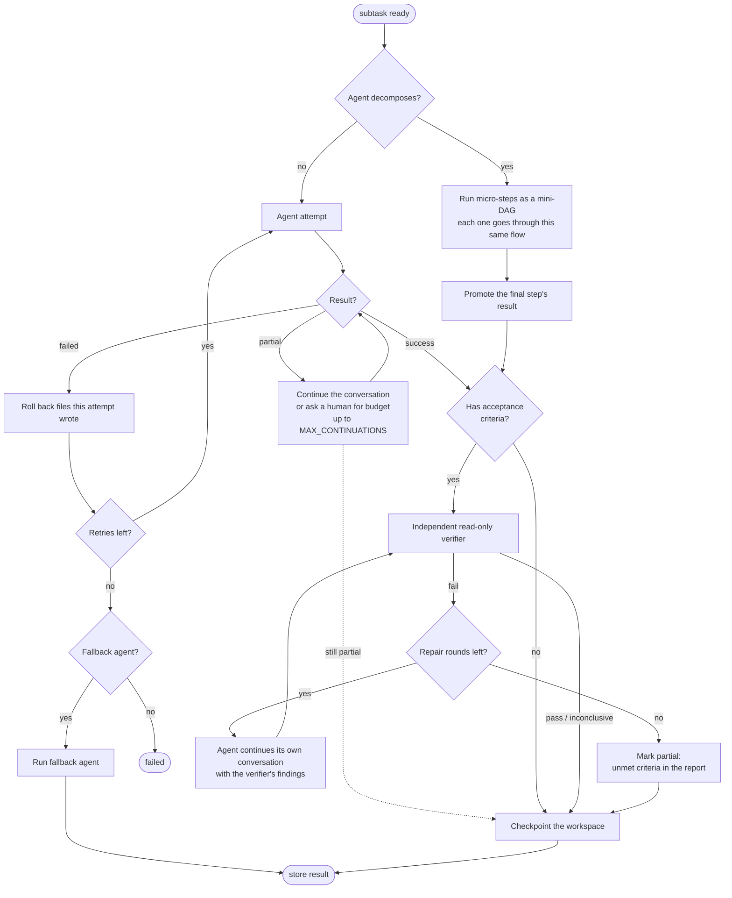
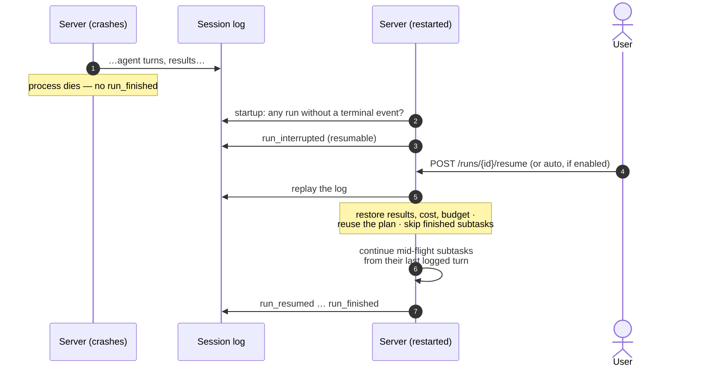
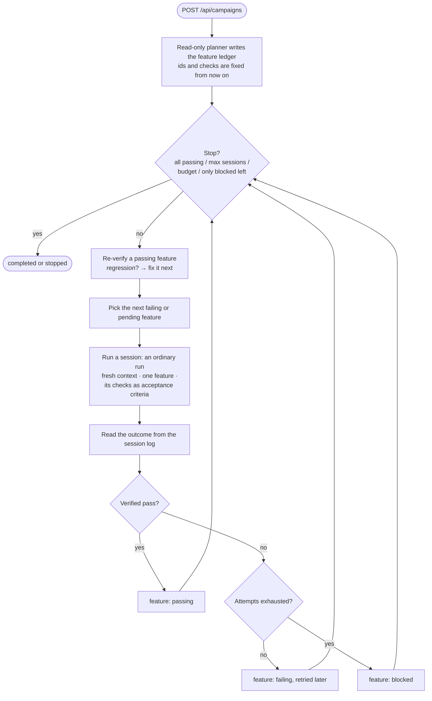
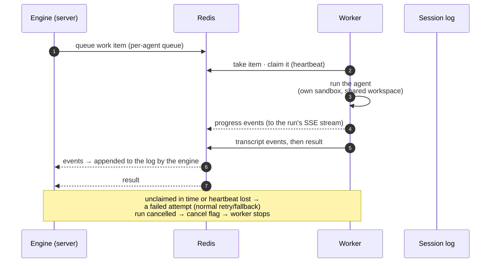

# Flows

Five things happen in AgentFlow: a run, a subtask inside it, a recovery after a crash, a
campaign session, and an agent call on a worker. Each is described below at the level
you need to reason about behaviour. The [KB](../kb/architecture.md) has the exact details.

## 1. A run, end to end

- **Planning.** By default the planner always runs. With `DIRECT_AGENT_ID` set, a cheap
  classifier can send simple tasks straight to one agent. Campaign sessions pass a ready
  plan and skip planning.
- **Dependencies.** A subtask receives its dependencies' results (summaries plus the
  files they wrote) in its first message. Large summaries are spilled to a file the agent
  can read.
- **Budget.** The run budget is split across subtasks by the planner's shares. When a
  subtask runs out, the run pauses for human input (`run:awaiting_input`) before spending
  more.

## 2. One subtask: attempt, verify, repair, checkpoint

**Inside every agent turn:**
- The conversation is shortened for the model (the context view) once it gets long.
- Each tool call passes the tool policies, then runs, in the sandbox if it executes code.
- Every message is appended to the session log.

## 3. Crash and resume

- **Unanswered tool requests are dropped.** If the agent had asked for tools whose
  results were never logged, that request is removed and the model asks again. It sees the
  workspace as the interrupted tools left it.
- **Multi-replica safety.** With several replicas, a run is only reconciled or resumed if
  no live replica holds its lease.
  [ADR-004](../adr/004-resume-from-log-with-leases.md)

## 4. A campaign session

- **Session instructions** carry the spec, overall progress, the previous session's own
  notes, and the feature's checks.
- **Pausing** takes effect after the current session. A restart pauses the campaign;
  resuming it finishes the interrupted session first.

## 5. An agent call on a worker

Only the agent's conversation and tool calls run on the worker. Planning, verification,
checkpoints and the log stay on the server, which is the session log's only writer.
[ADR-010](../adr/010-remote-agent-workers.md)
