# Overview

AgentFlow takes a task written in plain language, such as *"build a REST API for X"* or
*"research the EV market and write a report"*, and completes it with a team of specialist
AI agents. A planner splits the task into subtasks and assigns each to an agent (code,
research, writing, data…). The subtasks run in dependency order, in parallel where they
can. Each agent works with tools inside a workspace, and the results are combined into a
final report.

You start a run over HTTP (or with the CLI) and watch it live as a stream of events.

```mermaid
flowchart LR
    user([User / client]) -- "POST /api/runs<br/>task text" --> af
    user -- "GET …/stream (SSE)" --> af
    subgraph af [AgentFlow]
      direction TB
      plan[Plan] --> run[Run subtasks<br/>with agents] --> report[Compile report]
    end
    af -- LLM calls --> claude[(Claude API)]
    af -- web search / fetch --> web[(Web)]
    af -- reads & writes --> ws[(Workspace<br/>files)]
    af -. optional .- redis[(Redis)]
```

## What it can do

- **Plan and run multi-agent work.** The planner turns a task into a dependency graph of
  subtasks and routes each to an agent defined by a YAML manifest
  (`manifests/*.yaml`). Large subtasks can be split further into micro-steps.
- **Work in isolated workspaces.** Each run gets its own directory, or works in a named
  project workspace that successive runs keep building on.
- **Control cost.** Runs take an optional budget that is split across subtasks. Models
  are picked by tier (economy / standard / premium), and agents ask a human before
  overspending.
- **Keep a human in the loop.** You can send a message to a running agent, approve a
  budget increase, cancel, or start a follow-up run that builds on an earlier one.
- **Check its own work independently.** Subtasks can carry acceptance criteria that a
  separate, read-only verifier checks before the work counts as done.
- **Survive restarts.** Every run writes a durable session log. A run interrupted by a
  restart can be resumed where it stopped.
- **Run long projects.** A *campaign* builds something too big for one run as a series of
  fresh-context sessions over a feature list that only the verifier can mark as done.
- **Scale and isolate.** It can run as one process, as several API replicas sharing Redis,
  or with separate *worker* processes executing the agents. Agent-issued commands can run
  in a locked-down Docker container.

## The agents that ship with it

| Agent | Domain |
| --- | --- |
| `CodeAgent` | Software engineering (writes and tests code) |
| `FrontendAgent` | Frontend web development |
| `ResearchAgent` | Information retrieval (web, arXiv) |
| `DataAgent` | Data analysis |
| `WriterAgent` | Content and communication |
| `BusinessAnalystAgent`, `FinancialAnalystAgent` | Business and financial analysis |
| `PlannerAgent` | Strategy and decomposition |
| `KnowledgebaseAgent` | Semantic knowledge base (ingest and search, via an MCP server) |

Adding an agent means adding a manifest: its prompt, tools, skills, model tier and limits.
There's no new code. See the `/how-to` skill.

## Where to go next

- [Concepts](concepts.md) explains the vocabulary used throughout.
- [Flows](flows.md) walks through a run step by step.
